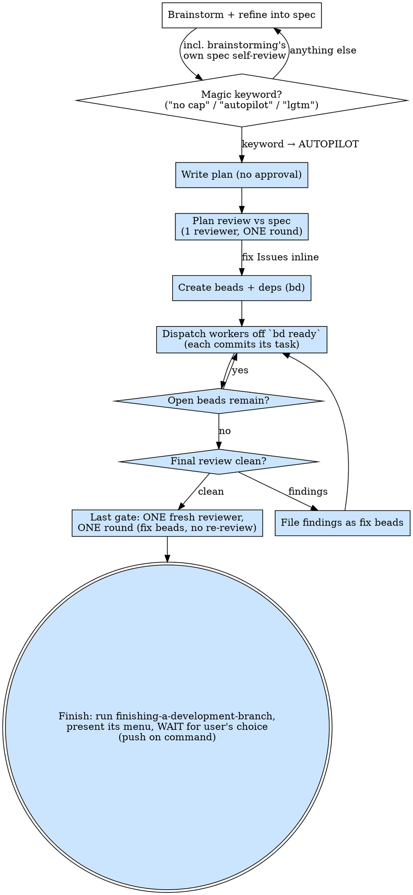

# Sol-Git-Gud

## Overview

## Single-Workspace / Single-Worktree Invariant

One pipeline runs in **one existing Paseo workspace and one shared checkout/worktree**, from planning through implementation, review, fixes, and acceptance. Record its workspace ID and absolute checkout path once; retain them across compaction and resumed runs. This placement rule takes precedence over generic worktree/isolation instructions in delegated skills.

- Create agents, not workspaces, for stages or tasks. From the pipeline workspace, omit `workspaceId` on `create_agent`; if the coordinator is elsewhere, pass the recorded pipeline `workspaceId` explicitly. Every helper must use the recorded checkout path.
- Do not call `create_workspace`, `git worktree add`, or create per-task branches during the pipeline. A different role/model, independent review, deadline, or collision risk is not an isolation exception. Only an explicit user request for different placement overrides this rule.
- Parallel editors require disjoint file ownership. Serialize overlapping edits, builds that share generated output, and all shared Git mutations. Reviewers are read-only; hold their reviewed files stable during a gate.
- Commit task files by explicit path in the shared checkout. No worker-to-integration cherry-picks or repeated checkout setup are needed.
- On resuming a legacy multi-worktree run, preserve existing work and report the mismatch. Agree on one canonical workspace and safely consolidate before launching further editing workers; never delete worktrees or discard changes to enforce this rule.

`lfg` loads context in, `touch-grass` flushes it out — **sol-git-gud is the SoL-Pi-aware middle: rough idea → shipped code**. Brainstorm to a spec, gate on a magic keyword, then run autopilot to completion with no further check-ins — planning, plan review, parallel workers, context-efficient execution, and final review all unattended.

**Core principle: exactly ONE human gate DURING the build — spec approval, opened ONLY by a magic keyword: "no cap", "autopilot", or "lgtm". Autopilot then runs uninterrupted through the fable gate; at Finish, finishing-a-development-branch presents its integration menu and autopilot WAITS for the user's choice — merging and pushing happen only on their word.**

**Violating the letter of the rules is violating the spirit of the rules.**

**REQUIRED SUB-SKILL:** Use `pi-agents` for every plan review, worker, implementation review, and fable review. All subagents in this workflow run through Paseo MCP; never use Pi's generic `Agent` or `SubagentWorkflow` tools. If Paseo is unavailable, stop and report the blocker as required by `pi-agents`.

## SoL-Pi Runtime Contract

SoL-Pi is an extension, not the `Agent` or `SubagentWorkflow` system. Use only mechanisms exposed by the effective `sol-pi.json`; never claim a disabled mechanism ran.

| Mechanism | Required behavior |
|---|---|
| Action Fusion | Attach the narrowest useful validation to `edit`/`write` through `then_run`. A failed command does not roll back the edit; inspect and fix it. |
| ObservationPack | When a large result becomes a stable handle, retrieve only needed pages with `obs_recall`; do not rerun the expensive command merely to recover omitted text. |
| Online Context Compact | Keep the complete active plan in `update_plan`. At every completed plan/bead boundary, mark the step complete and record concise `files_changed`, `verification`, and `decisions`; SoL-Pi decides whether to compact and continues automatically after successful compaction. |
| Evidence-Preserving Reducer | Use only when enabled and approved for the log's sensitivity. Disabled in the recommended profile. |

**Session preflight:** inspect the effective project/user `sol-pi.json` once. The project file replaces—not merges with—the user file. If Action Fusion, ObservationPack, or Online Context Compact is unavailable, continue safely with ordinary Pi behavior and state the degradation in the final report. Never edit configuration during an active build without user approval.

**Compaction discipline:** `update_plan` replaces the whole plan, permits at most one `in_progress` step, and is the authoritative bridge across compaction. Native `/compact`, ordinary auto-compaction, subagent summaries, and task trackers are not substitutes. After automatic continuation, rebuild execution state from the persisted plan and repository evidence before acting.

## Model Role Routing

Use this user-approved role matrix instead of generic "strongest profile" routing. These are model families, not saved Paseo profile names. Choose one eligible agent per job—not every model in the row. The last gate explicitly requires one fresh agent.

| Role | Eligible provider/model families |
|---|---|
| Main orchestrator | Fable via Claude · Opus via Claude · Astra via Pi · Sol via Pi |
| Plan, spec-compliance, code-quality and final reviewers | Opus via Claude · Terra via Pi |
| Building features, complex debugging, security and cross-cutting work | Opus via Claude |
| Simple, bounded, low-risk implementation or docs | Sonnet via Claude · Terra via Pi |
| Last gate: one fresh agent, one round | Fable via Claude |

**No simple-tier speed-tier model is in scope.** Without a Codex-Spark or AGY tier available, every bounded or low-risk task routes through Sonnet/Terra. Escalate ambiguous, complex, security-sensitive or cross-cutting work to Opus. No speed-tier model is eligible for orchestration or independent review.

**Claude-first routing budget:** target roughly **70% of eligible role assignments** to Claude across a pipeline run. When both routes are eligible, prefer Claude: Sonnet for simple work, Opus for complex work and ordinary reviews, Fable for the last gate. Terra via Pi supplies the remaining capacity and is the alternative for simple work and ordinary reviews. Count a role assignment once when a worker/reviewer is first assigned; reusing that agent for its related follow-ups does not alter the ratio. Do not create extra turns, agents, or unsuitable assignments merely to meet the target.

**Mix providers without creating extra agents beyond the one required last-gate agent.** Prefer an eligible existing owner/reviewer for follow-ups. For new implementation/review pairs, use Terra where needed for the routing budget or provider diversity; otherwise retain the Claude-first preference. Simple work uses Sonnet/Terra; building and complex work uses Opus. Reviewer independence and the reuse contract still apply; do not rotate agents just for variety. A simple worker whose task grows beyond its tier hands off to Opus with ownership and context recorded.

**Resolve before launch:** call `list_profiles` and select a matching role/model profile from its notes; materialize its settings per `pi-agents`. If none fits or profiles are empty, say so and use `list_providers`, `list_models`, and `inspect_provider` as needed. Verified discovery examples (recheck at launch, not permanent aliases): Terra `pi/openai-codex/gpt-5.6-terra`; Fable `claude/claude-fable-5-1`; Opus `claude/claude-opus-5`; Sonnet `claude/claude-sonnet-5`. Preserve Pi's nested model ID. Do not pass the literal family name or a guessed mode/feature. Apply the thinking-effort policy below instead of a profile's higher effort default, without silently broadening permissions.

No alternative providers are in scope for this skill. AGY routes and other external providers must not be selected. **Run Claude routes for real eligible pipeline work while its five-hour usage window remains available.** On a confirmed Claude usage-limit failure, record the event, stop creating or reusing Claude agents for the remainder of that window, and do not send probe/retry prompts solely to test the limit. Route only roles Terra is eligible for (simple work and ordinary reviews) to Pi; complex work and the Fable-only last gate become blockers. Do not create meaningless work to exhaust quota. On any other unavailable route, reuse or select an eligible same-role alternative and disclose the substitution. If none is available, report a blocker—do not silently move Opus into reviewing or Sonnet into complex building/orchestration, and do not introduce a non-listed provider to plug the gap.

**Astra and Sol are parent-orchestrator options only.** Discover their live Pi model IDs rather than guessing aliases. Their eligibility does not change worker/reviewer routing, the Claude-first subagent budget, or the Fable-only last gate. The Claude-limit restriction on routing work to Pi applies to subagent assignments, not an already eligible Astra/Sol parent; switching or handing off the parent still requires explicit user approval.

**Orchestrator preflight:** check the current model when exposed by the host. Do not change the running orchestrator or spawn a replacement automatically. If it is outside the main-orchestrator row (including discovery mid-run), pause and ask for a switch/handoff before further autonomous execution; if unknown, disclose that verification is needed. This row governs which model runs the parent, not an extra coordinating subagent.

### Subagent thinking-effort policy

Use low for simple bounded tasks; medium for implementation, complex debugging, plan review, spec review, code-quality review, the ordinary final-review loop, and the last-gate reviewer. This overrides higher effort in saved profiles and generic delegation guidance. Discover supported thinking option IDs before setting them; never guess IDs. Select an eligible model that supports the required effort; if unavailable, report the limitation rather than silently using high for ordinary subagents. For providers without an effort control, disclose that effort cannot be enforced and request a supported alternative. Reused agents retain their assigned effort unless their role changes; update settings before dispatch when necessary. Do not change global settings or the parent orchestrator's effort.

## Agent Reuse Contract

**Reuse context before creating agents.** This overrides subagent-driven-development's fresh-worker-per-task rule, not its two-stage review. Keep a small pool: normally one worker per active file-ownership lane and one independent reviewer. Reuse the plan reviewer for implementation/final review when suitably configured; create the one-fresh-agent last gate separately. That gate overrides reuse: one new agentId with no prior pipeline participation; the gate is single-seat.

Persist a compact roster in plan decisions: agentId, role/profile/effort, workspace, owned files/beads, reviewerId, expected follow-up, pending turn ID, last processed completion ID, spec/plan revision, last interaction. Rehydrate it after compaction.

### Context delivery and recovery

- First assignment: supply task ID, ownership, acceptance criteria, authoritative spec/plan paths and revisions, and required constraints once. Read the full plan initially or after a material change; otherwise read only relevant changed sections.
- Use delta-only follow-ups for a reused agent with retained context: finding IDs, changed requirements/files, verification, and the next concrete action. Do not append the original assignment, full plan, skill stack, or routine bootstrap commands again.
- Run `bd prime` on first assignment, confirmed context loss, or a beads-related error—not on every correction or commit turn. A new bead still needs a live targeted lookup and atomic claim; check live ownership/dependencies before task-state mutations. Remembered context is not authorization to skip those checks.
- After compaction, restore one compact checkpoint: goal, current task/stage, file ownership, latest commit/tests, pending turns, processed completions, and next action. Re-read only missing information or materially changed artifacts. Do not equate a compaction notice with complete context loss.
- A compaction notice is not completion: retain task/commit uncertainty, resume the same owner once with the checkpoint, and inspect the relevant commit/task evidence before retrying side effects. Repeated notice-only returns are a recovery blocker, not a reason to resend the full assignment indefinitely.
- Treat duplicate completion notifications as a no-op using agent/turn identity plus recorded commit/task evidence. A late result from an older turn must not complete a newer pending turn or trigger another dispatch/commit. If identity is ambiguous, reconcile once rather than guess.
- Review requests carry scope and acceptance criteria once. Re-review carries the finding/fix delta and affected invariants; broaden scope only for cross-cutting changes. Preserve separate independent spec and quality reviews and all required final gates.

| Situation | Required action |
|---|---|
| B finds a bug in A's work | File a fix bead owned by A; `send_agent_prompt` to A, then B for independent re-review. B remains read-only. |
| Related next bead | Reuse its available owner for sequential follow-ups; each bead retains its own claim, tests, review and commit. |
| Independent ready work | Reuse suitable idle workers first; create only for uncovered parallel lanes. Do not serialize disjoint work just to reduce agent count. |
| Owner busy | Queue its follow-up until idle; do not interrupt it or start a competing editor. |
| Owner unavailable, wrong workspace/profile, or unusable context | Record the reason; reuse another suitable non-reviewer first, otherwise create one replacement with a concise handoff. Preserve file isolation. |
| Final-review findings | Original owners fix; the same final reviewer re-reviews via `send_agent_prompt`. |

**One pending work turn per agentId.** Never send two concurrent beads to A. If related ready beads write disjoint files and must run in parallel, assign one to A and the other to a different suitable idle worker, or create one if none is available; record that bead's new owner. Ownership reuse does not override independent-lane concurrency. Likewise, serialize review turns on a shared reviewer.

### Common Lifecycle Mistakes

| Rationalization | Correction |
|---|---|
| "A is idle and authored auth—irrelevant; these are new beads" | Ownership survives bead boundaries; send related work back to A. |
| "Re-dispatch means a fresh reviewer" | It means another prompt to the same independent reviewer. |

## When to Use

- Underspecified feature the user expects delivered whole; "autopilot", "just build it", "ship it"
- NOT for: trivial fixes (systematic-debugging + TDD), users who want to drive each step (plain brainstorming), existing spec/plan (jump to Autopilot)

## Pipeline



## Phase 1 — Spec (the ONLY gate)

1. **Brainstorm — this IS the spec review.** REQUIRED SUB-SKILL: superpowers:brainstorming. Run its checklist as written, end to end. Loop — don't stop after one round. Spec (what/why: requirements, success criteria, edge cases) goes to its default location: `docs/superpowers/specs/YYYY-MM-DD-<topic>-design.md`. The plan is a **separate file** written later — never appended to the spec.

   **No separate hardening pass.** Brainstorming's own self-review IS the spec review. Reviewers on top of it never terminate — a root document has no reference to check against, so an attacker always finds more (measured: 3–6 rounds, and it invents features into the spec you're about to approve). The spec's check is you reading it at the gate.

   Brainstorming's step 8 ("ask the user to review the spec") **is** the gate — one ask, not two.
2. **Gate.** Present the written spec. The gate opens ONLY on a magic keyword — **"no cap"**, **"autopilot"**, or **"lgtm"** — any capitalization ("NO CAP", "nO Cap", "LGTM"), as the **entire trimmed reply**, and only in a **reply to the presented spec**. A keyword mixed with anything else ("lgtm but rename X", "not lgtm") is feedback, not approval: address it, re-present, and ask again. "Looks good" / "approved" / "go ahead" / "ship it" = positive feedback: acknowledge, then ask for a keyword. A keyword in the user's *initial request* selects this skill but pre-approves nothing — the gate needs a keyword again in reply to the spec. Once it lands, never ask for approval again.

## Autopilot — NO further gates

Run to completion. Initialize `update_plan` from the approved spec before planning begins, keep exactly one step `in_progress`, and update it at every phase and bead completion boundary. Plan records are concise evidence, not duplicated specs or raw logs. Follow `pi-agents` whenever this workflow delegates: list profiles, choose from their notes, materialize the selected profile into `create_agent`, keep completion notifications enabled, and use the Agent Reuse Contract for related beads, fixes and reviews. Never pause for plan approval, task-breakdown confirmation, progress check-ins, or "should I continue?". Legitimate stops only: unresolvable blocker, genuine ambiguity in the approved spec, Paseo unavailability, an orchestrator outside the approved role row requiring switch/handoff, or a review finding surviving two fix rounds.

### Reading subagent output (`paseo_get_agent_activity`)

The `notifyOnFinish` signal only tells you a run ended — it does not carry content. After the notification, read the result through `paseo_get_agent_activity`. **Standard limit is `5`** — it is the cheapest call that reliably returns the agent's final prose summary plus enough trailing tool context to verify it (~1.2k tokens on a typical run). Use the following escalation rules:

| What you see in `limit=5` | Action |
|---|---|
| The last entry is an assistant prose block (Markdown summary, verdict, decision) | Synthesize for the user. Done. |
| The last entry is a tool trace (`[Bash]`, `[Shell]`, `[Task]`, `[Toolsearch]`, etc.) | The agent stopped mid-tool or its last action was a command, not a conclusion. Re-query with `limit=10` to find the last prose block above it. |
| No prose block visible at `limit=10`, or the agent is in `error`/`closed` state | Re-query with no limit. Pay the token cost — you need the full tail to diagnose. |
| The `content` field is the agent's `[User]` echo or a stale `[User]` line | The run did not produce a real conclusion. Treat as a failed run; follow the failed-agentId recovery rule in the Agent Reuse Contract. |

Hard rules:
- Never call `get_agent_activity` with no `limit` for routine completion reads — the server caps at ~26 most-recent activities regardless, so the only thing an unparameterized call buys you is noise.
- The `content` field is the most-recent timeline entry, not necessarily the final assistant message. Always confirm the last entry is prose before treating it as the verdict.
- The `updateCount` field reports the total events in the run; if it is much larger than what `limit=5` returns, the head of the timeline is hidden — that is fine for normal reads but a reason to escalate when debugging.

1. **Plan.** REQUIRED SUB-SKILL: superpowers:writing-plans, at its default location `docs/superpowers/plans/YYYY-MM-DD-<feature-name>.md`. Opens with a link to the spec file and references its requirements — never restates them. Override the sub-skill's review pause: no plan approval, no execution-choice question — subagent-driven is already chosen.

   **Then review the plan — ONE round, ONE reviewer.** After writing-plans' self-review, create **one fresh Paseo plan-review agent** using `pi-agents`. Choose Opus via Claude or Terra via Pi under Model Role Routing; prefer cross-provider contrast with the orchestrator when possible. Never guess IDs. Use this prompt verbatim — the calibration is tuned upstream, **do not sharpen it into an attack**:

   ```
   You are a plan document reviewer. Verify this plan is complete and ready for implementation.

   **Plan to review:** [PLAN_FILE_PATH]
   **Spec for reference:** [SPEC_FILE_PATH]

   ## What to Check

   Completeness (TODOs, placeholders, missing steps) · Spec Alignment (covers every
   requirement, no scope creep) · Task Decomposition (clear boundaries, actionable
   steps) · Buildability (could an engineer follow this without getting stuck?)

   ## Calibration

   **Only flag issues that would cause real problems during implementation.**
   An implementer building the wrong thing or getting stuck is an issue.
   Minor wording, stylistic preferences, and "nice to have" suggestions are not.

   Approve unless there are serious gaps — missing requirements from the spec,
   contradictory steps, placeholder content, or tasks so vague they can't be acted on.

   ## Also return a file-ownership map — BOTH halves are required

   1. Tasks writing the same file with no dependency chaining them.
   2. Tasks writing disjoint files, which MUST stay unblocked and run in parallel.

   A fully serial chain is a FAILED review, not a safe one. Target shape: several
   independent heads (one file owner each) feeding a chain only where a file is
   genuinely shared.

   ## Output Format

   **Status:** Approved | Issues Found

   **Issues:** [Task X]: [issue] - [why it matters]

   **File ownership:** collisions: ... | must-parallel: ...

   **Recommendations (advisory, do not block approval):** ...
   ```

   This review terminates because the plan is checkable against the spec — and no human ever reads the plan.

   Route it. No second round, no gate — autopilot does not pause here:
   - **Issues** → fix inline, before beads exist. Missing requirement → add the task.
   - **Recommendations** → advisory. Drop or note in the final report. Never fix.
2. **Shared checkout + beads.** Use the recorded pipeline workspace and existing checkout/worktree. Do not invoke using-git-worktrees to create isolation; reuse the same checkout for every task and review. Then inside that checkout (bd v1.0.4):

   ```bash
   bd init --stealth --non-interactive     # --stealth: no commit, no scaffolding
   A=$(bd create "Task A" --silent)        # --silent prints just the ID
   B=$(bd create "Task B" --silent)
   bd dep "$A" --blocks "$B"               # B blocked by A
   ```

   **Never `--deps "blocks:A"` — that prefix is REVERSED** (typed form is `blocked-by:A`). Build the graph from the review's file-ownership map: disjoint-file tasks stay unblocked, shared-file writers chain. Unsure about **a specific pair** → add the dep — that tie-breaker is per-pair, not licence to chain the graph.

   **Before dispatching: does the first `bd ready` return more than one bead?** If it returns exactly one and the plan creates several new files, you over-serialized — fix the graph first.
   **Review verdict format — every task, final, and last-gate review.** Each review turn (spec compliance, code quality, final, last gate) is a separate prompt that names its scope and returns exactly:

   ```
   VERDICT: PASS | FAIL
   FINDINGS:
   - [Critical|Important|Minor] <file:line> — <what is wrong, evidence>
   (or: - none)
   ```

   Any Critical or Important finding forces `VERDICT: FAIL`; a PASS carrying one is malformed — send the reviewer a delta prompt asking for a consistent verdict, do not interpret it. Minor findings do not block. Prose without this block is not a verdict; a combined spec+quality reply is not two reviews.

3. **Dispatch Paseo workers off `bd ready`** — assign ready beads to the reusable owner pool via the lifecycle contract, following `pi-agents`. Several independent ready lanes → dispatch concurrently using existing idle agents before `create_agent`; blocked chains run sequentially as blockers close. Preserve superpowers:subagent-driven-development's two-stage review (spec compliance, then code quality): the same independent reviewer may perform both in separate turns, and must not implement the work it approves. Reuse that reviewer across beads and fix rounds; route every worker and reviewer through Paseo. Apply Model Role Routing: Opus for building and complex work, Sonnet/Terra for genuinely simple work, Opus/Terra for all independent reviews. Never guess provider/model/mode IDs. Every worker prompt states:
   - Use the Context delivery and recovery rules: conditional `bd prime`, delta-only reused-agent prompts, and live targeted bead checks/atomic claims. The live bd DB remains authoritative; context reuse does not waive task ownership checks.
   - Coordinator assigns ownership via `bd update "$ID" --assignee "$AGENT_ID"`. Worker claims only its assigned ready work via `bd --actor "$AGENT_ID" ready --assignee "$AGENT_ID" --claim --json`. Never take another owner's fix or bypass blockers; wait if none is ready.
   - TDD; commit your own task once tests are green (one commit per bead — per-task commits are the history, never squash).
   - Stage ONLY your task's files by explicit path — never `git add -A`/`git add .` in the shared worktree (sweeps a parallel worker's half-done changes into your commit). On `index.lock` error: wait and retry; don't delete it.
   - Never push, pull, fetch, or rebase.
   - `bd close "$ID"` only after the two-stage review passes.

   Re-check `bd ready`; repeat until no open beads remain.
4. **Final review — loop until clean.** Reuse one suitable independent Paseo reviewer from the roster (create only if none qualifies), selected via `pi-agents` and the Opus/Terra reviewer row, over the whole implementation **against the spec file**. Route the verdict mechanically:
   - Critical/Important findings → each becomes a new fix bead (link deps if coupled) → workers off `bd ready` as usual → **send the same reviewer a follow-up using its existing agentId**. Fix without re-review ≠ reviewed.
   - Minor/nitpicks → one batched cleanup bead or a note in the final report.
   - Same finding survives two fix rounds → stop, report blocker to the user.
   - Clean pass → one-fresh-reviewer last gate.
5. **Last review gate — ONE fresh subagent, ONE round.** After the final-review loop passes clean, create **one distinct new Paseo reviewer agent** in the same pipeline workspace. It starts with fresh context and has had no prior role in this pipeline. A warmed reviewer or a reset prompt does not qualify. Select from Fable via Claude using Model Role Routing's profile/discovery process. If Fable is unavailable, report a blocker; no fallback reviewer is eligible for the last gate.

   Launch one read-only review against the same implementation revision and spec. Give it spec/plan paths, diff/base reference, and verification evidence, not another reviewer's verdict. Cover the whole implementation with emphasis on (1) spec/correctness, (2) regressions/tests, and (3) security/edge cases — all three lenses in a single verdict block, not three reviewers. Freeze edits until the verdict returns. Record the agentId and verdict; one verdict satisfies the gate, even under deadline or budget pressure. A reviewer that returns no verdict block (provider limit, error, timeout, closed session) does not count: record the failed agentId and reason, create one new fresh agent against the same frozen revision, and keep edits frozen until a verdict exists. Never reuse the failed agent or accept a missing verdict.

   Deduplicate findings with evidence; retain unresolved disagreements rather than taking a majority vote. Route mechanically:
   - Critical/Important findings → fix beads → original owners off `bd ready` → then proceed to Finish. No second last-gate round; fixes still require workers' own two-stage independent review.
   - Minor/nitpicks → note in the final report.
   - Verdict clean → Finish (step 6: menu, then wait).
6. **Finish — menu, then WAIT.** REQUIRED SUB-SKILL: superpowers:finishing-a-development-branch. Run it as written: verify tests, detect environment, confirm the base branch, then **present its integration menu (merge locally / push + PR / keep as-is) and STOP until the user answers**. Autopilot never picks an option itself — "no further gates" does NOT extend to integration; merging or touching the base branch without the user's chosen option is a violation. Execute only the option they choose. **Push ONLY on the user's explicit command.**

   Before the menu, print the **final report** in exactly this shape; every "note in the final report" above lands here:

   ```
   ## Final report
   Spec: <path@revision>   Plan: <path@revision>   Base: <branch>
   Beads: <id> — <commit> — <owner agentId>   (one line each)
   Reviews: <scope> — <reviewer agentId> — PASS|FAIL — <n> findings   (task, final, last gate)
   Unresolved minors: <finding or none>
   Blockers hit: <what, how resolved, or none>
   Runtime degradation: <SoL-Pi mechanism unavailable, substitutions, or none>
   Claude quota: <active | exhausted; affected roles and Terra substitutions | not observed>
   Tests: <command> — <result>
   ```

## Red Flags — STOP

- "I basically understand it, start building" / "one round of questions is enough" → Loop until the spec is approved.
- "'Looks good' / 'go ahead' / 'approved' is approval" → Only a magic keyword opens the gate. Ask for one.
- "They're clearly happy, the keyword is a formality" → No keyword, no autopilot. No exceptions.
- "'autopilot' in their first message pre-approves the spec" → It selects this skill; the gate needs a keyword in reply to the presented spec.
- "Let me dispatch a reviewer to harden the spec" → No. Brainstorming's own self-review is the spec review; the gate is the rest. Extra reviewers on a root document loop and rewrite the spec under you.
- "Skip brainstorming's self-review, I'll eyeball it" → Run its checklist as written. Skipping it removes the only spec review that exists.
- "Brainstorming asked for spec approval, now I'll ask again for the keyword" → One ask. Brainstorming's step 8 IS the gate.
- "The plan is mine, I don't need it reviewed" → No human ever reads the plan. It gets one reviewer against the spec, every time.
- "Run another plan round" / "send several reviewers" → One reviewer, one round. Measured: extras return the same findings.
- "Chain every task — coupled is the safe default" / "serializing is safer" → Per-pair tie-breaker, not the whole graph. A fully serial chain is a FAILED review: `bd ready` yields one bead at a time and parallel dispatch never happens.
- "I'll write a sharper attack prompt for the plan" → Template verbatim. Attack framing caused the loop; "approve unless" ends it.
- "Plan review means pausing" / "confirm the plan with the user" / "should I continue?" → Forbidden. Fix Issues inline, keep going. The spec is the only gate.
- "This Recommendation is quick, I'll fix it" → Advisory. Drop or note it.
- "Append the plan to the spec file" → Two files. The plan links to the spec, never restates it.
- "New bead, new agent" / "B found it, B should fix it" → Reuse owner A for fixes and related work; B independently re-reviews. `bd` still tracks each bead; readiness drives dispatch.
- "Pi's generic `Agent` is close enough" / "I'll silently fall back if Paseo fails" → No. `pi-agents` is mandatory; report the blocker and ask before using another mechanism.
- "Every follow-up needs `bd prime` and the whole plan again" → Bootstrap once; refresh on confirmed context loss, relevant changes, or beads errors. Keep live targeted ownership/dependency checks.
- "Paseo delegation is a SoL-Pi mechanism" → No. Paseo owns delegation; name only the four mechanisms in the runtime contract as SoL-Pi.
- "Native compaction is close enough" / "bd already tracks progress" → No. Online Context Compact depends on complete `update_plan` transitions at completed-work boundaries.
- "I can rerun the command instead of recalling the packed result" → Use `obs_recall` for the archived observation; rerun only when fresh execution is substantively required.
- "then_run passed, so the edit is fully verified" → It proves only that command. Continue the prescribed targeted and broad verification gates.
- "Parallelize everything" → Only disjoint-file beads run together. Shared-file writers chain — see the file-ownership map.
- "Close the bead when code's written" → Only after the two-stage review passes.
- "Self-review is enough" → Final review is a separate reviewer, not the implementer approving itself.
- "Reviewer findings are small, I'll fix them myself" / "one pass is done" → Findings → fix beads → re-review. Only a clean pass ends the loop.
- "One warmed reviewer is enough; deadline/budget is tight" / "two turns count as two reviewers" / "only Fable is available, so use one" → Last gate requires exactly one fresh distinct agentId and an independent verdict, one round.
- "Run the last gate again after fixes" / "skip it, final review was clean" → Exactly one one-agent last-gate round. Wait for the verdict; fixes route through original owners and their two-stage reviews, then Finish.
- "`git add -A` to be safe" → Explicit paths only in the shared worktree.
- "Sync with `git pull --rebase`" / "squash the worker commits" / "I'll push it for them" → Never during autopilot; per-task commits stay; push waits for the user's command.
- "Last gate is clean, I'll merge to the base branch to wrap up" / "git-gud says no further gates, so integration is pre-approved" → No. finishing-a-development-branch presents its menu and autopilot WAITS there; the user picks the integration option, never you.
